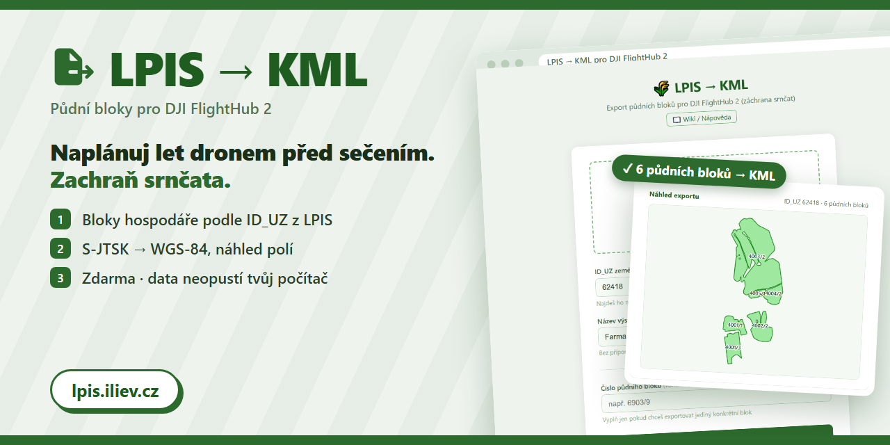
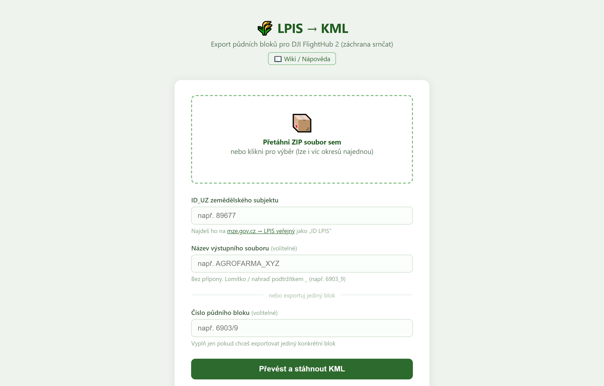
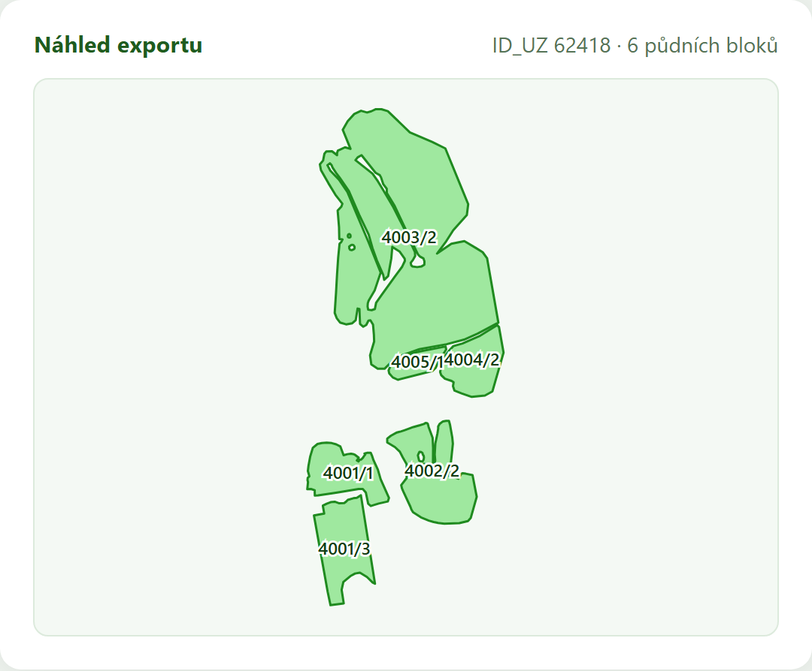
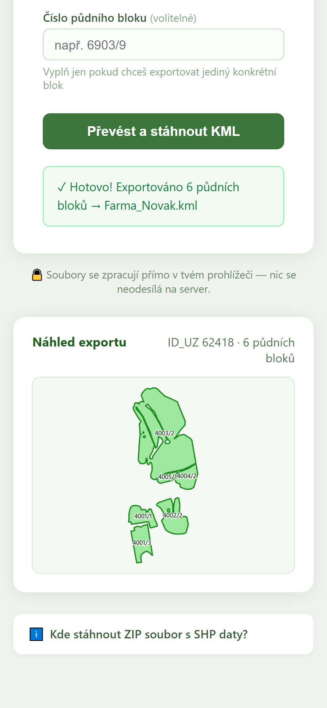
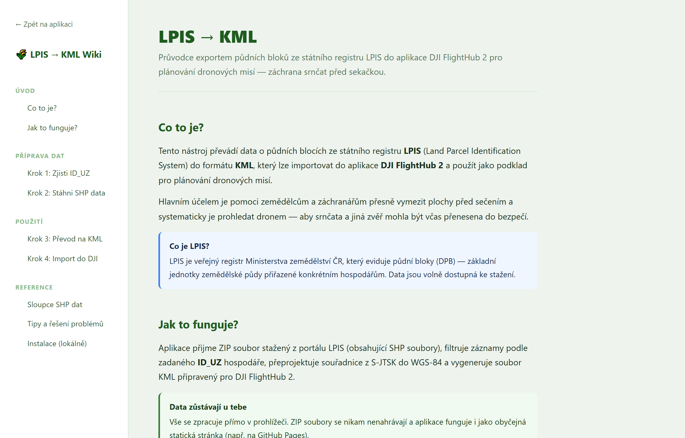

# LPIS → KML for DJI FlightHub 2

A web app that converts Czech agricultural land parcel data (LPIS) from Shapefile format into KML files ready to import into **DJI FlightHub 2** for drone mission planning.

Primary use case: scanning fields with a drone before mowing to rescue fawns and other wildlife.

[](https://nix3r.github.io/LPIStoKML/)

**▶ Live app: [nix3r.github.io/LPIStoKML](https://nix3r.github.io/LPIStoKML/)** · [Wiki (CZ)](https://nix3r.github.io/LPIStoKML/wiki.html)

Runs entirely in the browser: the ZIP is unpacked, filtered and reprojected on your computer and never uploaded anywhere. The whole app is a static page, hosted on GitHub Pages.

| Converter | Export preview | Phone | Wiki |
|:---:|:---:|:---:|:---:|
|  |  |  |  |

---

## How it works

1. Download a SHP ZIP for your district from the public [LPIS data portal](https://mze.gov.cz/public/app/eagriapp/lpisdata/)
2. Open the web app, pick the ZIP (or several, one per district) and enter your **ID_UZ** (farmer's LPIS identifier)
3. The browser filters the parcels, reprojects coordinates from S-JTSK (EPSG:5514) to WGS-84, shows a preview and downloads a KML file
4. Import the KML into DJI FlightHub 2 via **Map Annotations → Import**

All land parcels appear on the map labelled with their block numbers (e.g. `4003/2`).

---

## Run locally

No build step and no backend. Serve the `web/` folder with any static server:

```bash
python -m http.server 5000 --directory web
```

or with the bundled Flask server (used by `start.sh` for the self-hosted systemd service):

```bash
pip install -r requirements.txt
python app.py
```

Open [http://localhost:5000](http://localhost:5000).

### Tests

```bash
node --test "tests/*.test.js"
```

Converts `test/20260523-930318-DPB-SHP.zip` (ID_UZ `62418`) and checks the coordinates against pyproj.

### Deploy

Every push to `main` runs the tests and publishes `web/` to GitHub Pages (`.github/workflows/pages.yml`).
One-time setup: repo **Settings → Pages → Source: GitHub Actions**. The workflow rewrites the absolute
`og:url` / `og:image` link-preview URLs to the actual Pages URL (also works with a custom domain).

### Screenshots and link preview

`docs/images/*.png` and `web/og-image.png` (1280×640 link-preview image, composed by `tools/og-image.html`) are generated with Playwright:

```bash
npm i --no-save playwright && npx playwright install chromium
node tools/screenshots.mjs
```

---

## Usage

### Getting your ID_UZ

Every farmer registered in the Czech LPIS system has a unique **ID_UZ** number (also called *ID LPIS*).

1. Go to [mze.gov.cz → LPIS public register](https://mze.gov.cz/public/app/lpisext/lpis/verejny2/plpis/)
2. Search by municipality name in the **Obec** tab
3. Click the farmer's name in the results
4. Note the **ID LPIS** number (e.g. `89677`) — this is your ID_UZ

### Downloading the SHP data

1. Go to [eagri.cz → LPIS data](https://mze.gov.cz/public/app/eagriapp/lpisdata/)
2. Filter by **district** (okres)
3. Set **Entita = DPB**, **Typ = SHP**
4. Click *Vygenerovat seznam souborů*
5. Download the first row where *Území = Okres* (covers the whole district)

> **Note:** If a farmer operates across multiple districts, download a ZIP for each district.

### Converting

| Field | Required | Description |
|---|---|---|
| ZIP file(s) | ✓ | SHP ZIP downloaded from LPIS; select several to merge districts |
| ID_UZ | ✓ | Farmer's LPIS identifier |
| Output filename | — | Name for the KML file (default: `lpis_export`) |
| Block number | — | Export a single parcel only (e.g. `4003/2`) |

Leave **Block number** empty to export all parcels for the given ID_UZ at once.

---

## Project structure

```
├── web/                    # The static site (published to GitHub Pages)
│   ├── index.html          # Converter UI
│   ├── wiki.html           # Documentation (Czech)
│   ├── og-image.png        # Link-preview image
│   └── js/
│       ├── lpis.js         # ZIP → SHP/DBF → WGS-84 → KML (no DOM, also runs in Node)
│       ├── app.js          # UI: upload, download, preview
│       └── lib/            # Vendored fflate 0.8.2, proj4js 2.22.0 (MIT)
├── tests/                  # node --test
├── tools/                  # Playwright screenshots + og:image composer
├── app.py                  # Optional Flask static server (self-hosting)
└── docs/                   # Original manual (Czech), README images
```

---

## Tech stack

| Library | Purpose |
|---|---|
| [fflate](https://github.com/101arrowz/fflate) | Unzipping in the browser |
| [proj4js](https://github.com/proj4js/proj4js) | S-JTSK → WGS-84 reprojection |

Shapefile/DBF reading and KML writing are small hand-written parsers in `web/js/lpis.js`.

---

## Notes

- **Coordinate system:** LPIS data uses S-JTSK / Krovak (EPSG:5514). The app reprojects to WGS-84 (EPSG:4326) as required by KML, using the same 7-parameter datum shift as PROJ/pyproj (matches to < 1 cm; the shift in the LPIS `.prj` alone would be ~10 m off).
- **3D geometry:** LPIS polygons are `POLYGON Z` — Z values are stripped in the output KML.
- **Block name column:** The app looks for `ZKOD_DPB` first (short code like `4003/2`), falling back to `NKOD_DPB` and others.
- **Holes:** blocks with enclaves keep all their inner rings. Multi-part blocks become one placemark per part.
- **Text encoding:** DBF text is read as Windows-1250 unless a `.cpg` file says otherwise.
- **File size:** files are processed in browser memory; district exports are fine, whole-region files can be slow.
- **Data freshness:** LPIS data is updated weekly — always download the latest export.

---

## License

MIT
